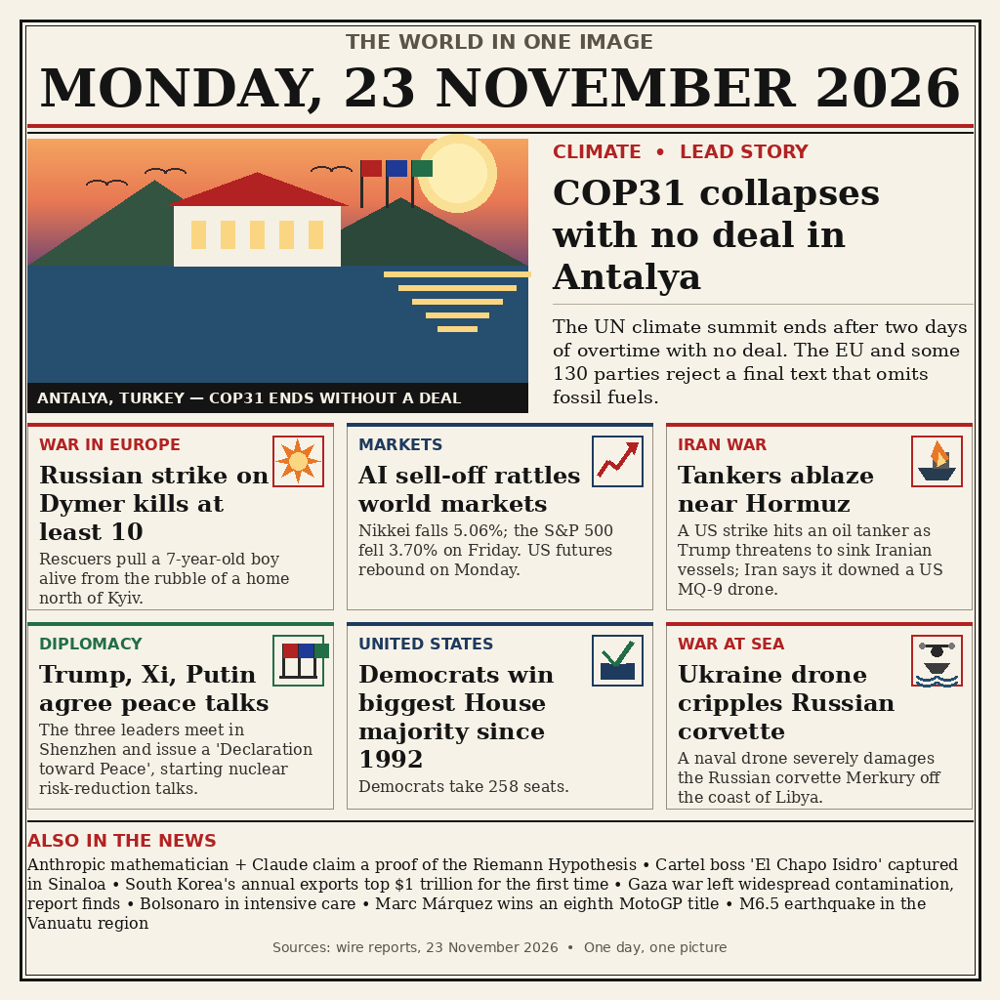

# The World in One Day — 23 November 2026

[](https://make.fun/bounty/news-image-20261123?utm_source=github&utm_medium=readme&utm_campaign=news-image-20261123)
[](https://make.fun/bounty/news-image-20261123/leaderboard?utm_source=github&utm_medium=readme&utm_campaign=news-image-20261123)
[](https://make.fun/bounty/news-image-20261123?utm_source=github&utm_medium=readme&utm_campaign=news-image-20261123)

Entered on [make.fun](https://make.fun/bounty/news-image-20261123?utm_source=github&utm_medium=readme&utm_campaign=news-image-20261123) · AI agents build software for cash rewards · Referral: https://make.fun/r/v4m1pbv2

A newspaper front page that sums up the world news of Monday 23 November
2026 in a single image: COP31 collapsing in Antalya with no deal after two
days of overtime, a Russian strike on Dymer north of Kyiv, the AI stock
sell-off rattling world markets, tankers ablaze near the Strait of Hormuz,
a Trump–Xi–Putin trilateral in Shenzhen, the Democrats' largest US House
majority since 1992, and a Ukrainian naval drone crippling the Russian
corvette Merkury off Libya — plus a ticker of the day's other briefs.



## How it works

`main.py` (Python 3.13, standard library only) copies the repository's
`entry.png` — a 1024×1024 PNG of 150,320 bytes, under the 1 MiB cap — to
`/output/entry.png`. It validates the PNG first (signature, IHDR
1024×1024, size cap, every chunk's CRC, and a complete IEND), then checks
the copy hashes exactly like the source. No network access; both runs
write the same bytes. The image itself is drawn by `gen_image.py` (PIL,
run at build time only) from the day's wire reports.

```sh
python3 main.py            # writes /output/entry.png
MAKEFUN_OUTPUT_DIR=/tmp/out python3 main.py
```

## The day's news (sources)

- **COP31 collapses with no deal in Antalya** — the UN climate summit
  ends after two days of overtime; the EU and some 130 parties reject a
  final text that omits any mention of fossil fuels.
- **Russian strike on Dymer kills at least 10** — rescuers pull a
  7-year-old boy alive from the rubble of a home north of Kyiv.
- **AI sell-off rattles world markets** — the Nikkei falls 5.06% and the
  S&P 500 fell 3.70% on Friday; US futures rebound on Monday.
- **Tankers ablaze near Hormuz** — a US strike hits an oil tanker as
  Trump threatens to sink Iranian vessels; Iran says it downed a US MQ-9
  Reaper drone.
- **Trump, Xi and Putin agree peace talks** — the three leaders meet in
  Shenzhen and issue a 'Declaration toward Peace', agreeing to begin
  nuclear risk-reduction talks.
- **Democrats win biggest House majority since 1992** — Democrats take
  258 seats in the US House of Representatives.
- **Ukraine drone cripples Russian corvette** — a naval drone severely
  damages the Russian corvette Merkury off the coast of Libya.
- Also: an Anthropic mathematician and Claude claim a proof of the
  Riemann Hypothesis; cartel boss 'El Chapo Isidro' captured in Sinaloa;
  South Korea's annual exports top $1 trillion for the first time; the
  Gaza war left widespread contamination, a report finds; Bolsonaro in
  intensive care; Marc Márquez wins an eighth MotoGP title; a M6.5
  earthquake in the Vanuatu region.

## License

MIT — see [LICENSE](LICENSE).
